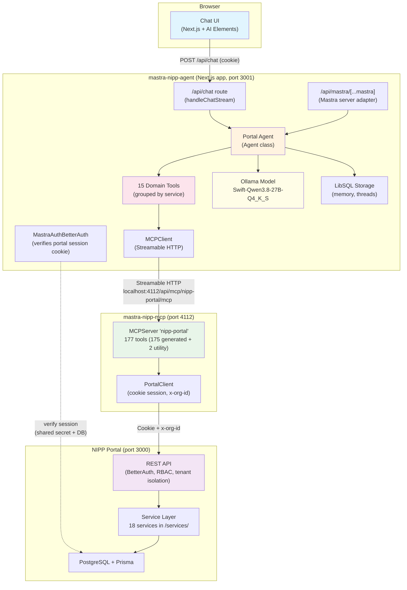
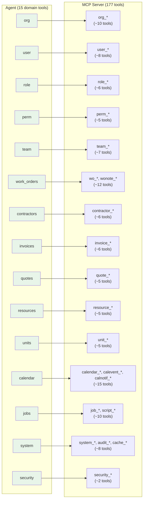
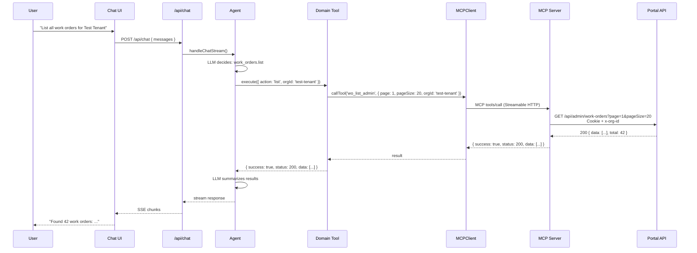
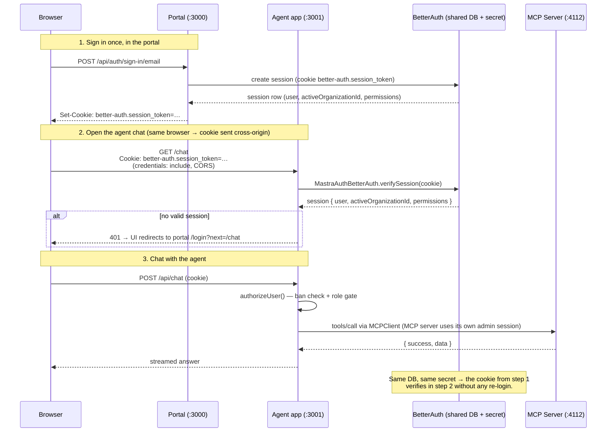
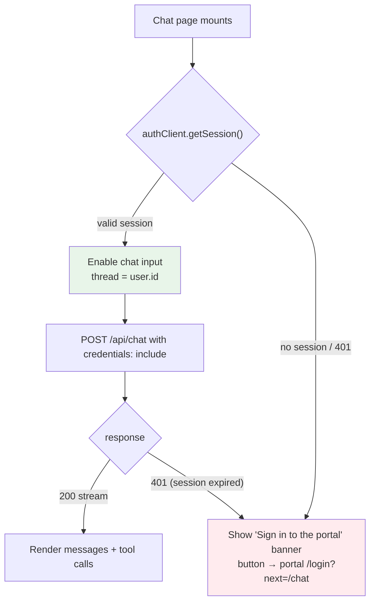
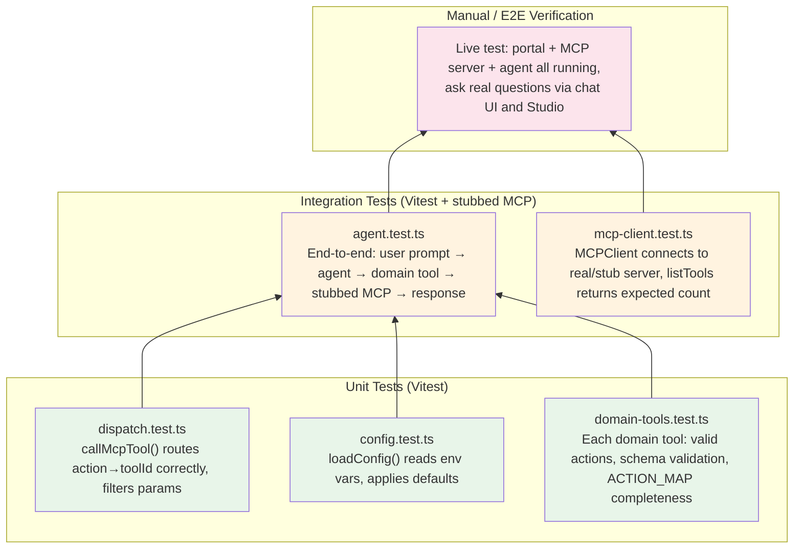

# NIPP Portal Agent — Design Document

**Project:** `mastra-nipp-agent`
**Date:** 2026-11-10
**Status:** Design (pre-implementation)
**Companion doc:** `PLAN.md` (multi-phase implementation plan)

---

## 1. Purpose

Build a Mastra AI agent that controls the NIPP property-management portal through its
REST API, using the existing Portal MCP server as the bridge:

```
User ──► Next.js Chat UI ──► Mastra Agent ──► Portal MCP Server ──► Portal API ──► Portal App
         (AI SDK UI)          (Ollama 27B)      (mastra-nipp-mcp)     (Next.js 16)    (nipp-0111)
```

The agent answers natural-language questions and performs administrative actions
(list organizations, create work orders, transition states, manage users, etc.)
by calling the portal's API through MCP tools.

**Key constraint:** The agent must not expose all 175+ endpoint-level MCP tools
directly to the LLM. That would consume excessive context space and overwhelm a
local 27B model. Instead, tools are **grouped by service domain** — the same
breakdown used by the portal's own `services/` layer — reducing the tool surface
from ~177 to ~15 domain-level tools.

---

## 2. System Architecture



### Component responsibilities

| Component | Responsibility |
|-----------|---------------|
| **Chat UI** | Streaming chat interface using AI SDK UI + AI Elements. Renders text, tool calls, and tool results. |
| **`/api/chat` route** | Bridges the browser to the agent via `handleChatStream`. Manages thread/resource IDs for memory. |
| **Mastra server adapter** | Exposes Mastra's full HTTP API (agents, tools, MCP) through Next.js at `/api/mastra/*`. Enables Studio and programmatic access. |
| **Portal Agent** | The `Agent` instance. Holds instructions, model config, domain tools, and memory. Decides which tool to call and how to interpret results. |
| **Domain Tools (15)** | Grouped by service domain. Each tool takes an `action` enum + params and dispatches to the correct MCP tool via a shared dispatcher. |
| **MCPClient** | Connects to the Portal MCP server over Streamable HTTP. Provides `listTools()` for discovery and `callTool()` for execution. |
| **Ollama Model** | Local LLM (`Swift-Qwen3.8-27B-Q4_K_S:latest`) via OpenAI-compatible Chat Completions API at `localhost:11434/v1`. |
| **LibSQL Storage** | Persists agent message history, threads, and agent state (Mastra memory). |
| **BetterAuth (agent side)** | Verifies the portal's session cookie on every request to the Mastra server. Same `BETTER_AUTH_SECRET` + same PostgreSQL DB as the portal → a cookie minted by the portal at `:3000` is valid in the agent at `:3001`. Provides per-user identity, ban checks, and the user's active organization for tenant-scoped tool calls. |
| **Portal MCP Server** | Existing project (`mastra-nipp-mcp`). Holds a BetterAuth cookie session, translates MCP tool calls into authenticated HTTP requests to the portal. |
| **Portal API** | The NIPP portal's Next.js REST API. Enforces RBAC, tenant isolation, and all business logic. |

---

## 3. Tool Grouping Strategy

### 3.1 Why group?

The Portal MCP server exposes **177 tools** (175 generated from the OpenAPI spec +
2 utility). Each tool carries a name, description, and JSON input schema. Loading
all 177 into the agent's tool list would:

- Consume ~30–50K tokens of context just for tool definitions (depending on schema size)
- Overwhelm a local 27B model's ability to select the right tool
- Make the system prompt fragile to spec changes

**Grouping by service domain** reduces this to **~15 tools**, each with a compact
`action` enum and a unified input schema. The LLM sees 15 clear, well-named tools
instead of 177 endpoint-level ones.

### 3.2 Domain mapping

The portal's `services/` directory defines the canonical domain breakdown. Each
domain tool maps to one or more MCP tool prefixes:



### 3.3 Domain tool schema pattern

Each domain tool follows the same shape:

```typescript
createTool({
  id: '<domain>',
  description: 'Manage <domain> in the NIPP portal. Actions: list, get, create, update, delete.',
  inputSchema: z.object({
    action: z.enum(['list', 'get', 'create', 'update', 'delete']),
    orgId: z.string().optional(),   // tenant targeting (all domains)
    page: z.union([z.string(), z.number()]).optional(),
    pageSize: z.union([z.string(), z.number()]).optional(),
    // domain-specific params (all optional; execute() filters by action)
    id: z.string().optional(),
    name: z.string().optional(),
    // ...
  }),
  execute: async (input) => {
    const mcpToolId = ACTION_MAP[input.action];  // e.g. 'user_list_admin'
    return callMcpTool(mcpClient, mcpToolId, input);
  },
});
```

The `ACTION_MAP` is a simple `{ action: mcpToolId }` lookup per domain. The
`execute()` function:

1. Resolves the MCP tool ID from the action
2. Filters the input to only the fields relevant to that MCP tool (drops
   irrelevant params so the portal doesn't reject them)
3. Calls `mcpClient.callTool(toolId, filteredInput)`
4. Returns the MCP tool's result (`{ success, status, data | error }`)

### 3.4 Action catalog per domain

| Domain | Actions | MCP tool prefix(es) |
|--------|---------|---------------------|
| `org` | list, get, create, update, set_status | `org_*_admin`, `org_*_dash` |
| `user` | list, get, create, update, ban, unban | `user_*_admin`, `user_*_dash` |
| `role` | list, get, create, update, delete, add_member, remove_member, set_permissions | `role_*` |
| `perm` | list, get, create, update, delete | `perm_*_admin` |
| `team` | list, get, create, update, delete, add_member, remove_member | `team_*_admin`, `team_*_dash` |
| `work_orders` | list, get, create, update, transition, add_note, list_notes, deadline_scan | `wo_*_admin`, `wonote_*_admin` |
| `contractors` | list, get, create, update, delete | `contractor_*_admin`, `contractor_*_dash` |
| `invoices` | list, get, create, update, delete | `invoice_*_admin` |
| `quotes` | list, get, create, update | `quote_*_admin` |
| `resources` | list, get, create, update, delete | `resource_*_admin` |
| `units` | list, get, create, update, delete | `unit_*_admin` |
| `calendar` | list_calendars, get_calendar, create_calendar, update_calendar, delete_calendar, list_events, get_event, create_event, update_event, delete_event, upcoming_events | `calendar_*`, `calevent_*` |
| `jobs` | list, get, create, update, delete, run, dry_run, approve, history | `job_*_admin`, `script_*_admin` |
| `system` | health, session_verify, audit_logs, cache_metrics, notifications | `portal_health`, `portal_session_verify`, `system_*`, `audit_*` |
| `security` | create_payload_key, revoke_payload_key | `security_*` |

**Total: 15 domain tools covering all 177 MCP tools.**

### 3.5 Context savings estimate

| Approach | Tools in context | Est. tokens (tool defs) |
|----------|-----------------|------------------------|
| All 177 MCP tools directly | 177 | ~40,000–60,000 |
| 15 domain tools (grouped) | 15 | ~3,000–5,000 |

This is an **~90% reduction** in tool-definition context, leaving more room for
conversation history and tool results within the model's window.

---

## 4. Agent Design

### 4.1 Model configuration

The agent uses a local Ollama model via Mastra's `OpenAICompatibleConfig`:

```typescript
import type { MastraModelConfig } '@mastra/core/llm';

const model: MastraModelConfig = {
  id: 'ollama/Swift-Qwen3.8-27B-Q4_K_S:latest',
  url: process.env.OLLAMA_BASE_URL ?? 'http://localhost:11434/v1',
  apiKey: 'ollama',           // placeholder — Ollama ignores it
  api: 'chat',                // Chat Completions (NOT Responses API)
};
```

**Why not the model-router string format (`openai/gpt-5.6-sol`)?** The router
resolves `openai/` to the Responses API, which Ollama does not implement. The
typed `OpenAICompatibleConfig` routes to `/v1/chat/completions`, which Ollama
does support.

### 4.2 Agent instructions

The agent's system prompt establishes:

- Identity: NIPP portal administrator assistant
- Tool usage conventions: domain tools, action enums, org targeting
- Safety: confirm destructive operations before executing
- Error handling: interpret `{ success: false }` responses and report to user
- Pagination: use `page`/`pageSize` for list actions; summarize results
- Multi-step: chain tool calls for complex requests (e.g., "find the org, then
  list its work orders")

### 4.3 Memory

```typescript
new Memory({
  options: {
    workingMemory: false,
    // observational memory off for v1 — 27B model context is limited
  },
})
```

- **Thread-based**: each chat session gets a thread ID (user-scoped)
- **Resource**: fixed to `nipp-portal-agent`
- **Storage**: LibSQL (file-based, `mastra.db`)
- **Observational memory**: disabled for v1 (background agent would add latency
  on a local model; revisit if context management becomes an issue)

---

## 5. MCP Client Connection

```typescript
import { MCPClient } from '@mastra/mcp';

export const portalMcp = new MCPClient({
  id: 'portal-client',
  servers: {
    nippPortal: {
      url: new URL(process.env.PORTAL_MCP_URL ?? 'http://localhost:4112/api/mcp/nipp-portal/mcp'),
    },
  },
});
```

The MCP client connects to the existing `mastra-nipp-mcp` server over Streamable
HTTP. The agent does **not** register the MCP server's tools directly — instead,
the domain tools' `execute()` functions call `portalMcp.callTool(toolId, input)`
to dispatch to specific MCP tools on demand.

**Why not `tools: await portalMcp.listTools()`?** That would load all 177 tools
into the agent's tool list, defeating the grouping strategy. By calling
`callTool()` imperatively from domain tools, we keep the LLM-facing tool surface
at 15 while retaining access to all 177 MCP tools.

### Request flow



---

## 5.5 BetterAuth Integration (shared session with the portal)

### 5.5.1 Why

The portal (`nipp-0111`) authenticates users with **BetterAuth** (Prisma adapter,
PostgreSQL via PgBouncer, `organization` + `bearer` plugins, custom user/session
extensions: `permissions`, `isSuperAdmin`, `activeOrganizationId`). The agent app
runs on a different port (`:3001`) — without auth, anyone who can reach the agent
can drive the portal as the MCP server's super-admin session.

**Design decision:** the agent verifies the *same* BetterAuth sessions the portal
issues. Because both apps share `BETTER_AUTH_SECRET` and the same PostgreSQL DB,
a cookie minted by the portal at `:3000` is cryptographically valid in the agent
at `:3001`. No separate login page in the agent — users sign in once in the
portal; the agent chat UI checks their session and redirects to the portal's
login if absent.

This gives, for free:
- **Per-user identity** (replaces the MCP server's single shared super-admin
  session as the *identity* layer — see §5.5.4)
- **Ban enforcement** (BetterAuth's session hooks + portal's `enforceBanStatus`)
- **Active organization context** (`activeOrganizationId` on the session) for
  tenant-scoped tool calls

### 5.5.2 Auth flow



### 5.5.3 Wiring (Mastra side)

`src/mastra/auth.ts` builds a **thin** BetterAuth instance for verification only —
it does not mount sign-in routes (the portal already owns those):

```typescript
import { betterAuth } from 'better-auth/minimal';
import { prismaAdapter } from 'better-auth/adapters/prisma';
import { PrismaClient } from '@prisma/client';

// Read-only verification instance: same secret + DB as the portal.
const prisma = new PrismaClient({ datasources: { db: { url: process.env.DATABASE_URL! } } });

export const agentAuth = betterAuth({
  baseURL: process.env.BETTER_AUTH_URL ?? 'http://localhost:3000',
  secret: process.env.BETTER_AUTH_SECRET!,   // MUST equal the portal's secret
  database: { provider: 'prisma', prismaClient: prisma },
  emailAndPassword: { enabled: true },
});
```

`src/mastra/index.ts` registers it on the Mastra server:

```typescript
import { MastraAuthBetterAuth } from '@mastra/auth-better-auth';

const mastraAuth = new MastraAuthBetterAuth({
  auth: agentAuth,
  public: ['/health'],
  // everything else (agents, chat, MCP) is protected by default
  async authorizeUser(user) {
    const u = user?.user;
    if (!u) return false;
    if (u.banned && !(u.banExpires && new Date(u.banExpires) < new Date())) return false;
    // v1 gate: any authenticated portal user. Tighten to isSuperAdmin later.
    return true;
  },
});

export const mastra = new Mastra({
  server: {
    auth: mastraAuth,
    cors: { origin: 'http://localhost:3000', credentials: true }, // portal origin
  },
  storage: new LibSQLStore({ id: 'mastra-storage', url: 'file:/Users/johnlynas/dev/mastra-nipp-agent/mastra.db' }),
  agents: { portalAgent },
});
```

**Client side** (`src/lib/auth-client.ts`): the standard `better-auth/client`
instance pointed at the **portal** origin, so it can read/create sessions through
the portal's own handler and redirect unauthenticated users to the portal login:

```typescript
import { createAuthClient } from 'better-auth/react';

export const authClient = createAuthClient({ baseURL: process.env.NEXT_PUBLIC_PORTAL_URL ?? 'http://localhost:3000' });
```

### 5.5.4 Identity vs. execution session (important nuance)

Two sessions coexist, and the design keeps their roles distinct:

| Session | Held by | Role |
|---------|---------|------|
| **User's portal cookie** (`better-auth.session_token` for user X) | Browser → agent app | *Identity*: who is chatting, ban check, default `orgId` (their `activeOrganizationId`) |
| **MCP server admin session** (Platform super-admin) | `mastra-nipp-mcp` process | *Execution*: the actual API calls to the portal |

For v1 the agent executes through the MCP server's shared super-admin session
(the MCP server does not accept per-request user cookies). The user's identity is
used for: access gating (`authorizeUser`), memory thread scoping (per-user
threads), and **default tenant targeting** — when a domain tool omits `orgId`,
the agent injects the caller's `activeOrganizationId` from their verified session
instead of the Platform org. The portal's own RBAC/RLS still enforces every call,
so an over-broad execution session cannot exceed what the portal allows.

> **Future (Phase 10):** per-user execution — pass the user's cookie to the MCP
> server (e.g. via `requestInit` headers on a per-request MCPClient, or a portal
> API-token feature) so tool calls run as the actual user, not the super-admin.

### 5.5.5 Chat UI auth handling



- `useChat` transport: `new DefaultChatTransport({ api: '/api/chat', credentials: 'include' })`
- Thread ID = authenticated user's id (per-user memory), resource = `nipp-agent`
- On 401 from `/api/chat`, show the sign-in banner (session may have expired)

### 5.5.6 Env vars (agent `.env`)

| Variable | Value | Meaning |
|----------|-------|---------|
| `BETTER_AUTH_SECRET` | *(same string as portal `.env`)* | Session verification key — must match the portal exactly |
| `BETTER_AUTH_URL` | `http://localhost:3000` | Portal origin (session cookie base) |
| `DATABASE_URL` | *(portal's PgBouncer URL)* | Shared session DB for verification |
| `NEXT_PUBLIC_PORTAL_URL` | `http://localhost:3000` | Client-side redirect target for login |

### 5.5.7 Risks specific to shared-session auth

| Risk | Mitigation |
|------|-----------|
| Secret/DB mismatch between apps → every request 401s | `.env.example` documents both must match; integration test asserts a portal-issued cookie verifies in the agent (Phase 3) |
| Cross-origin cookies blocked (SameSite) | BetterAuth default is `Lax`; same-site localhost works. For LAN access from other machines, set `BETTER_AUTH_TRUSTED_ORIGINS` on the portal (it already supports this) — noted in `.env.example` |
| Agent app leaking session data | `authorizeUser` returns only a boolean; user object never reaches tool inputs or logs. Memory stores messages only, keyed by user id |
| Prisma schema drift (agent's generated client vs portal DB) | Agent uses the portal's Prisma schema for generation (`prisma generate` from `nipp-0111/prisma/schema.prisma`); CI type-check catches drift |

---

## 6. Next.js Integration

The agent lives inside a **Next.js App Router** project for compatibility with
the portal app (same framework, same tooling patterns).

### 6.1 Project structure

```
mastra-nipp-agent/
├── package.json              # type: module, next + mastra deps
├── tsconfig.json             # strict, bundler resolution
├── next.config.ts            # Next.js config (serverExternalPackages for mastra)
├── .env / .env.example       # OLLAMA_*, PORTAL_MCP_URL, etc.
├── .gitignore
├── src/
│   ├── mastra/
│   │   ├── index.ts              # Mastra instance (agent, storage, server auth)
│   │   ├── config.ts             # env → AgentConfig
│   │   ├── auth.ts               # BetterAuth verification instance (shared secret + DB)
│   │   ├── agents/
│   │   │   └── portal-agent.ts   # Agent definition
│   │   ├── mcp/
│   │   │   └── client.ts         # MCPClient → nipp-portal
│   │   └── tools/
│   │       ├── index.ts          # re-export all domain tools
│   │       ├── dispatch.ts       # shared callMcpTool() helper
│   │       ├── org-tool.ts
│   │       ├── user-tool.ts
│   │       ├── role-tool.ts
│   │       ├── perm-tool.ts
│   │       ├── team-tool.ts
│   │       ├── wo-tool.ts
│   │       ├── contractor-tool.ts
│   │       ├── invoice-tool.ts
│   │       ├── quote-tool.ts
│   │       ├── resource-tool.ts
│   │       ├── unit-tool.ts
│   │       ├── calendar-tool.ts
│   │       ├── job-tool.ts
│   │       ├── system-tool.ts
│   │       └── security-tool.ts
│   ├── lib/
│   │   └── auth-client.ts        # better-auth client → portal origin (session check, login redirect)
│   └── app/
│       ├── layout.tsx
│       ├── page.tsx              # redirect → /chat
│       ├── globals.css
│       ├── chat/
│       │   └── page.tsx          # streaming chat UI (AI Elements)
│       └── api/
│           ├── chat/
│           │   └── route.ts      # handleChatStream endpoint
│           └── mastra/
│               └── [...mastra]/
│                   └── route.ts  # Mastra server adapter (Studio, API)
├── tests/
│   ├── unit/
│   │   ├── dispatch.test.ts
│   │   ├── config.test.ts
│   │   └── domain-tools.test.ts
│   └── integration/
│       ├── agent.test.ts
│       ├── mcp-client.test.ts
│       └── auth.test.ts          # portal-issued cookie verifies in agent; banned user rejected
└── docs/
    ├── DESIGN.md                 # this document
    └── PLAN.md                   # implementation plan
```

### 6.2 Key Next.js considerations

- **Port**: `3001` (portal uses `3000`, MCP server uses `4112`)
- **Server adapter**: `@mastra/next` mounted at `/api/mastra/[...mastra]` —
  exposes Mastra's full API (agents, tools, Studio) through Next.js
- **Chat route**: `/api/chat` using `handleChatStream` from `@mastra/ai-sdk`
- **AI Elements**: Radix UI component library for chat rendering
- **Storage path**: absolute (`file:/Users/johnlynas/dev/mastra-nipp-agent/mastra.db`)
  so `next dev` and `mastra dev` share the same database

---

## 7. Security Considerations

| Concern | Mitigation |
|---------|-----------|
| **Portal credentials** | Live only in `mastra-nipp-mcp/.env` (gitignored). The agent never sees them — it talks to the MCP server, which holds the cookie session. |
| **MCP endpoint unauthenticated** | Binds to localhost:4112. Not exposed externally. Documented as a known limitation; Phase 10 can add auth. |
| **Destructive operations** | Agent instructions mandate confirmation before delete/ban/status-change actions. A `requireToolApproval` gate on the agent (Mastra human-in-the-loop) is planned for Phase 10. |
| **Tenant isolation** | Enforced by the portal API (`x-org-id` header). The MCP server always sends it. Domain tools accept optional `orgId` to target a specific tenant. |
| **Prompt injection via tool results** | Tool results are data, not instructions. Agent instructions explicitly state that tool output should be treated as data only. |
| **Local model data exposure** | All inference runs locally on Ollama. No data leaves the machine except HTTP calls to localhost services. |

---

## 8. Testing Strategy



### 8.1 Unit tests

| Test file | What it covers | Mocks |
|-----------|---------------|-------|
| `dispatch.test.ts` | `callMcpTool()` resolves action→toolId, filters input params, handles MCP errors | Mock `MCPClient.callTool()` |
| `config.test.ts` | `loadConfig()` reads env vars, applies defaults for OLLAMA_BASE_URL, PORTAL_MCP_URL | Set/unset `process.env` |
| `domain-tools.test.ts` | Each of the 15 domain tools: input schema validates, ACTION_MAP covers all actions, no orphan MCP tool IDs | Mock `MCPClient` |

### 8.2 Integration tests

| Test file | What it covers | Setup |
|-----------|---------------|-------|
| `agent.test.ts` | Full agent loop: prompt → LLM (stubbed) → domain tool execute → stubbed MCP → response text. Verifies the agent picks the right domain tool and action. | Stub Ollama endpoint (return canned tool-call JSON), stub MCP server (in-memory `MCPServer` with a few tools) |
| `mcp-client.test.ts` | `MCPClient.listTools()` returns 177 tools when connected to real server; graceful failure when server is down. | Real MCP server (if running) or skip |

### 8.3 Test runner

**Vitest** with `vitest.config.ts`:

```typescript
import { defineConfig } from 'vitest/config';
import path from 'path';

export default defineConfig({
  test: {
    include: ['tests/**/*.test.ts'],
    environment: 'node',
    globals: true,
  },
  resolve: {
    alias: { '@': path.resolve(__dirname, './src') },
  },
});
```

Run: `npx vitest run` (unit + integration), `npx vitest run tests/unit` (unit only).

---

## 9. Configuration Reference

### 9.1 Agent `.env`

| Variable | Default | Meaning |
|----------|---------|---------|
| `OLLAMA_BASE_URL` | `http://localhost:11434/v1` | Ollama OpenAI-compatible endpoint |
| `OLLAMA_MODEL` | `Swift-Qwen3.8-27B-Q4_K_S:latest` | Model ID (no `ollama/` prefix — added in code) |
| `PORTAL_MCP_URL` | `http://localhost:4112/api/mcp/nipp-portal/mcp` | Portal MCP server Streamable HTTP endpoint |
| `BETTER_AUTH_SECRET` | — *(must equal portal's)* | BetterAuth session verification key |
| `BETTER_AUTH_URL` | `http://localhost:3000` | Portal origin (session cookie base) |
| `DATABASE_URL` | — *(portal's PgBouncer URL)* | Shared PostgreSQL for session verification |
| `NEXT_PUBLIC_PORTAL_URL` | `http://localhost:3000` | Client-side login redirect target |
| `PORT` | `3001` | Next.js dev server port |

### 9.2 Dependencies (npm)

| Package | Purpose |
|---------|---------|
| `next`, `react`, `react-dom` | Next.js App Router |
| `@mastra/core` | Agent, tools, Mastra instance |
| `@mastra/mcp` | MCPClient (connect to portal MCP server) |
| `@mastra/memory` | Memory (message history, threads) |
| `@mastra/libsql` | Storage provider for memory |
| `@mastra/ai-sdk` | `handleChatStream` for AI SDK UI integration |
| `@mastra/next` | Next.js server adapter (exposes Mastra API) |
| `@mastra/auth-better-auth` | `MastraAuthBetterAuth` — verifies portal sessions on the Mastra server |
| `better-auth` | BetterAuth core (`minimal` + Prisma adapter for session verification) |
| `@prisma/client` + `prisma` (dev) | Session DB access for auth verification (schema from portal) |
| `@ai-sdk/react`, `ai` | AI SDK UI (useChat, streaming) |
| `zod` | Schema validation (tool inputs) |
| `hono` | Peer dependency for `@mastra/next` |
| `vitest` | Test runner (dev) |

---

## 10. Risks & Open Questions

| # | Risk / Question | Impact | Mitigation |
|---|----------------|--------|-----------|
| 1 | **27B model tool-calling reliability**: local models can be less reliable at multi-step tool use than cloud frontier models. The agent may pick wrong actions or hallucinate params. | High | Thorough integration tests with canned prompts. Agent instructions include explicit action examples. If reliability is insufficient, consider a larger model or cloud fallback. |
| 2 | **MCP server availability**: if `mastra-nipp-mcp` is not running, all domain tools fail. | Medium | Domain tools return a clear error message ("Portal MCP server not reachable at ..."). Chat UI displays the error. |
| 3 | **Spec drift**: portal API changes → OpenAPI spec changes → MCP tools change → domain tool ACTION_MAPs become stale. | Medium | `domain-tools.test.ts` validates that every ACTION_MAP value exists in the MCP server's tool list (integration test). CI can run this against a live MCP server. |
| 4 | **Context window pressure**: even with 15 tools, long conversations + tool results can exceed the 27B model's context. | Medium | Memory processors (trim/prioritize) can be enabled. Observational memory is a future option. Keep responses concise in agent instructions. |
| 5 | **Portal sign-in rate limiting**: if the MCP server's session expires frequently, re-authentication trips the portal's 429 limit. | Low | Already handled by the MCP server (shared client, 30s cooldown, retry-once on 401). Agent is not directly affected. |
| 6 | **Ollama model name**: `Swift-Qwen3.8-27B-Q4_K_S:latest` — confirm this is a tool-capable model (supports function calling / tool use in Chat Completions). If the model does not support tool calling, the agent cannot use tools at all. | High | Verify with `ollama run Swift-Qwen3.8-27B-Q4_K_S:latest "Use the get_weather tool to check SF"` before Phase 4. If unsupported, select a different local model. |
| 7 | **Port conflicts**: portal (3000), MCP (4112), agent (3001) — ensure no conflicts with other local services. | Low | Documented in `.env.example`. `PORT` is configurable. |
| 8 | **Shared-secret coupling**: agent and portal must keep `BETTER_AUTH_SECRET` in sync; a rotation on one side silently breaks the other (all requests 401). | Medium | `.env.example` warns both files must match; integration test (`auth.test.ts`) fails fast on mismatch. Document rotation procedure: update both, restart both. |
| 9 | **Agent DB client vs portal schema**: the agent's Prisma client is generated from the portal's schema; if the portal adds session/user fields, the agent client goes stale. | Low | Generate from `nipp-0111/prisma/schema.prisma` (symlink or copy step in Phase 3); type-check catches drift. |

### Open questions (resolve during implementation)

1. **Thread ID strategy**: resolved — thread = authenticated user's id (per-user
   memory), resource = `nipp-agent`. No auth → no chat (401 + sign-in banner).
2. **AI Elements vs. minimal UI**: AI Elements adds many components. If the
   install is heavy, fall back to a minimal `useChat` + plain HTML chat UI.
3. **Mastra Studio access**: the server adapter exposes Studio at
   `/api/mastra/studio`. With BetterAuth enabled on the Mastra server, Studio
   requests must carry the portal cookie (browser flow handles this via CORS
   credentials). Confirm Studio works with the Ollama model in Phase 6.
4. **v1 role gate**: any authenticated portal user can use the agent (execution
   still runs through the MCP super-admin session, constrained by portal RBAC).
   Decide whether to restrict to `isSuperAdmin` / specific roles — default: open,
   tighten in Phase 10 with per-user execution.

---

## Appendix A: Portal service → domain tool mapping detail

| Portal service file | Domain tool | MCP tool prefix(es) | Key actions |
|---------------------|-------------|---------------------|-------------|
| `organization-service.ts` | `org` | `org_*_admin`, `org_*_dash` | list, get, create, update, set_status |
| `user-service.ts` | `user` | `user_*_admin`, `user_*_dash` | list, get, create, update, ban, unban |
| `role-service.ts` | `role` | `role_*` | list, get, create, update, delete, members, permissions |
| `permission-service.ts` | `perm` | `perm_*_admin` | list, get, create, update, delete |
| `team-service.ts` | `team` | `team_*_admin`, `team_*_dash` | list, get, create, update, delete, members |
| `work-order-service.ts` | `work_orders` | `wo_*_admin` | list, get, create, update, transition |
| `work-order-note-service.ts` | `work_orders` (notes) | `wonote_*_admin` | add_note, list_notes |
| `contractor-service.ts` | `contractors` | `contractor_*_admin`, `contractor_*_dash` | list, get, create, update, delete |
| `invoice-service.ts` | `invoices` | `invoice_*_admin` | list, get, create, update, delete |
| `quote-service.ts` | `quotes` | `quote_*_admin` | list, get, create, update |
| `resource-service.ts` | `resources` | `resource_*_admin` | list, get, create, update, delete |
| `unit-service.ts` | `units` | `unit_*_admin` | list, get, create, update, delete |
| `calendar-service.ts` | `calendar` | `calendar_*` | list_calendars, get, create, update, delete |
| `calendar-event-service.ts` | `calendar` (events) | `calevent_*` | list_events, get, create, update, delete, upcoming |
| `calendar-notification-service.ts` | `calendar` (notifications) | `calnotif_*` | notification_history |
| `job-scheduler-service.ts` | `jobs` | `job_*_admin`, `script_*_admin` | list, get, create, update, delete, run, dry_run, approve, history |
| (system endpoints) | `system` | `portal_health`, `portal_session_verify`, `system_*`, `audit_*` | health, session_verify, audit_logs, cache_metrics |
| (security endpoints) | `security` | `security_*` | create_payload_key, revoke_payload_key |
