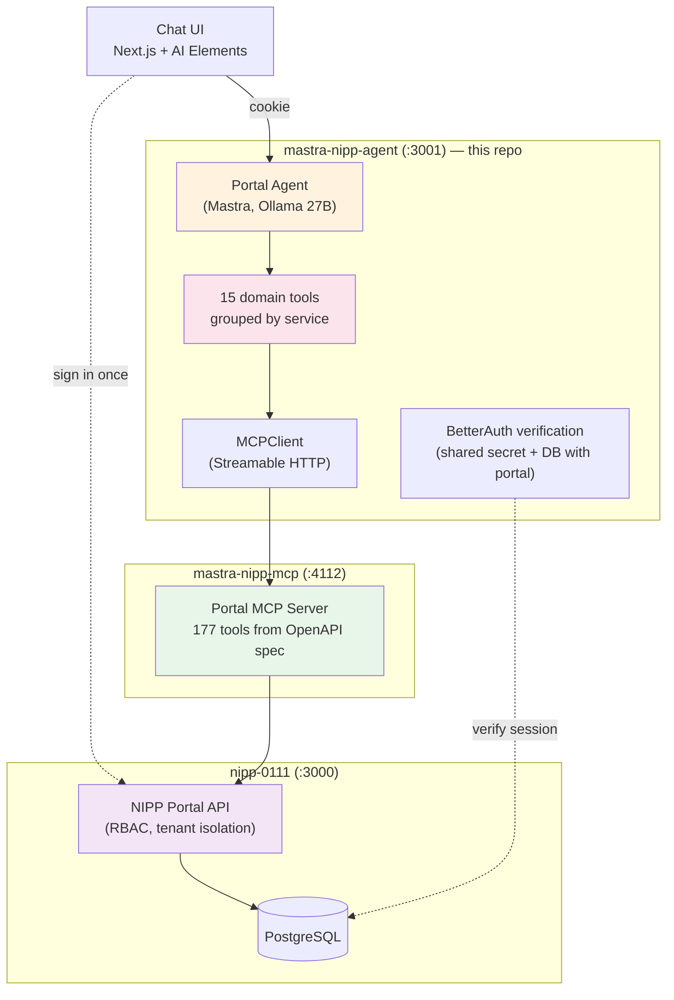
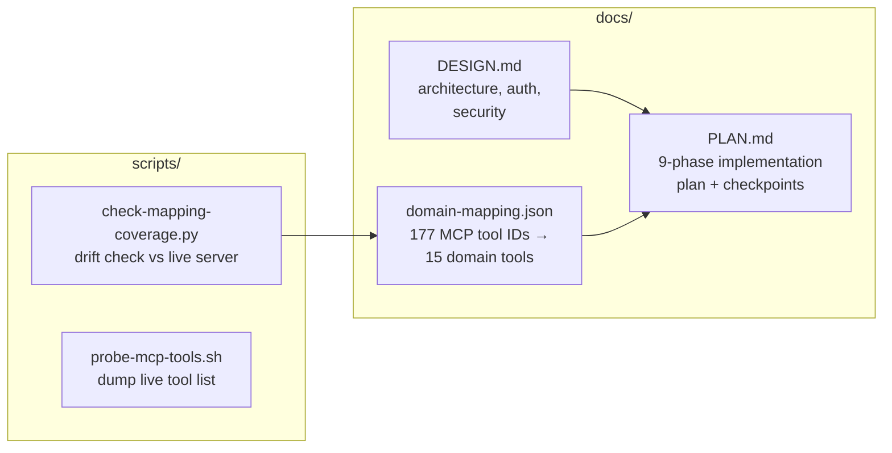

# mastra-nipp-agent

A Mastra AI agent that controls the **NIPP property-management portal** through
its REST API — using the existing Portal MCP server as the bridge. You ask in
plain language ("list work orders for Test Tenant", "ban that user"), the agent
picks the right tool, and the portal's own RBAC enforces every call.

This repo is currently in its **planning stage**: it contains the design, the
multi-phase implementation plan, and the ground-truth tool mapping that Phase 5
will build from. The agent code lands here as the phases are executed (see
[docs/PLAN.md](./docs/PLAN.md)).

## How it fits together



The key design decision: the portal's MCP server exposes **177 endpoint-level
tools**. Loading all of them into a local 27B model would burn ~40–60K tokens
of context and overwhelm tool selection. So the agent exposes only **15 domain
tools** (one per service area), each with an `action` enum that dispatches to
the right MCP tools on demand — a ~90% reduction in tool-definition context.

## What's in this repo



| Path | What it is |
|------|-----------|
| [docs/DESIGN.md](./docs/DESIGN.md) | The full design: system architecture, tool-grouping strategy, BetterAuth shared-session auth, security model, risks. Read this first. |
| [docs/PLAN.md](./docs/PLAN.md) | The multi-phase implementation plan (Phases 1–9), each with steps, acceptance criteria, and a commit checkpoint. This is the working checklist. |
| [docs/domain-mapping.json](./docs/domain-mapping.json) | Ground truth: every one of the 177 live MCP tool IDs mapped to a domain-tool action (or explicitly deferred to v2). Generated from a live `tools/list` call on 2026-11-10. |
| [scripts/check-mapping-coverage.py](./scripts/check-mapping-coverage.py) | Probes the live MCP server and verifies the mapping still covers every tool — exits non-zero on drift. Run it after any portal OpenAPI spec change, before Phase 5. |
| [scripts/probe-mcp-tools.sh](./scripts/probe-mcp-tools.sh) | Dumps the MCP server's current tool list to `/tmp/mcp_tools_raw.txt` for debugging. |

## Dependencies (sibling repos / services)

| Service | Where | Role |
|---------|-------|------|
| NIPP portal (`nipp-0111`) | `:3000` | The app being controlled; owns login, RBAC, all business logic |
| Portal MCP server (`mastra-nipp-mcp`) | `:4112` | Translates MCP tool calls into authenticated portal API requests |
| Ollama | `:11434` | Local LLM — `Swift-Qwen3.8-27B-Q4_K_S:latest` |

The agent will run on **`:3001`**. Start order when implementing: portal → MCP
server → agent.

## Getting started (once implementation begins)

```bash
# 1. Read the docs
open docs/DESIGN.md   # what we're building and why
open docs/PLAN.md     # how, in which order, and what "done" means

# 2. Verify your environment matches the plan's assumptions
python3 scripts/check-mapping-coverage.py   # needs portal + MCP server running
```

Then follow Phase 1 of [docs/PLAN.md](./docs/PLAN.md) — each phase ends with a
named commit checkpoint, so the git history doubles as progress tracking.
