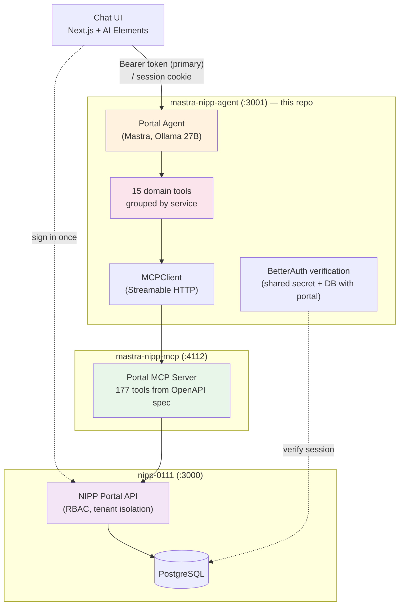
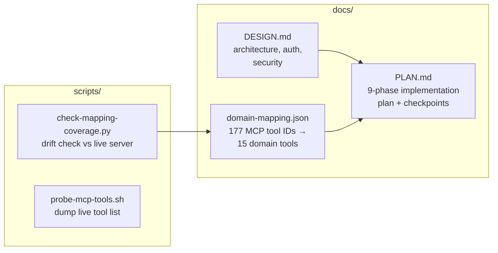

# mastra-nipp-agent

A Mastra AI agent that controls the **NIPP property-management portal** through
its REST API — using the existing Portal MCP server as the bridge. You ask in
plain language ("list work orders for Test Tenant", "ban that user"), the agent
picks the right tool, and the portal's own RBAC enforces every call.

This repo is currently in its **planning stage**: it contains the design, the
multi-phase implementation plan, and the ground-truth tool mapping that Phase 5
will build from. The agent code lands here as the phases are executed (see
[docs/PLAN.md](./docs/PLAN.md)).

## How it fits together



The key design decision: the portal's MCP server exposes **177 endpoint-level
tools**. Loading all of them into a local 27B model would burn ~40–60K tokens
of context and overwhelm tool selection. So the agent exposes only **15 domain
tools** (one per service area), each with an `action` enum that dispatches to
the right MCP tools on demand — a ~90% reduction in tool-definition context.

### Auth: two doors

The chat UI is embedded as an iframe inside the portal's admin Agent page, so
it authenticates through two doors (in order):

1. **Bearer token (primary).** The portal appends `?agentToken=*** to the
   iframe URL; the UI sends it back as `Authorization: Bearer *** better-auth's
   `bearer()` plugin rewrites that into a session cookie for the request, and
   the token is HMAC-verified against the shared `BETTER_AUTH_SECRET`. This is
   immune to the `__Secure-` cookie-name mismatch that breaks cookie auth over
   plain HTTP in production.
2. **Session cookie (fallback).** For direct browser access, the agent
   normalizes the portal's `__Secure-better-auth.session_token` name onto the
   non-secure name `getSession()` reads — so cookie auth works in both dev and
   prod instead of silently 401-ing.

## What's in this repo



| Path | What it is |
|------|-----------|
| [docs/DESIGN.md](./docs/DESIGN.md) | The full design: system architecture, tool-grouping strategy, BetterAuth shared-session auth, security model, risks. Read this first. |
| [docs/PLAN.md](./docs/PLAN.md) | The multi-phase implementation plan (Phases 1–9), each with steps, acceptance criteria, and a commit checkpoint. This is the working checklist. |
| [docs/domain-mapping.json](./docs/domain-mapping.json) | Ground truth: every one of the 177 live MCP tool IDs mapped to a domain-tool action (or explicitly deferred to v2). Generated from a live `tools/list` call on 2026-11-10. |
| [scripts/check-mapping-coverage.py](./scripts/check-mapping-coverage.py) | Probes the live MCP server and verifies the mapping still covers every tool — exits non-zero on drift. Run it after any portal OpenAPI spec change, before Phase 5. |
| [scripts/probe-mcp-tools.sh](./scripts/probe-mcp-tools.sh) | Dumps the MCP server's current tool list to `/tmp/mcp_tools_raw.txt` for debugging. |

## Dependencies (sibling repos / services)

| Service | Where | Role |
|---------|-------|------|
| NIPP portal (`nipp-0111`) | `:3000` | The app being controlled; owns login, RBAC, all business logic |
| Portal MCP server (`mastra-nipp-mcp`) | `:4112` | Translates MCP tool calls into authenticated portal API requests |
| Ollama | `:11434` | Local LLM — `Swift-Qwen3.8-27B-Q4_K_S:latest` |

The agent runs on **`:3001`**. Start order: portal → MCP server → agent.

## Environment variables

Copy `.env.example` to `.env` and fill in the blanks. Every variable has a
sane localhost default except where noted — the defaults match the standard
local dev layout (portal `:3000`, MCP server `:4112`, Ollama `:11434`).

| Variable | Default | Meaning |
|----------|---------|---------|
| `OLLAMA_BASE_URL` | `http://localhost:11434/v1` | Ollama's OpenAI-compatible Chat Completions endpoint |
| `OLLAMA_MODEL` | `Swift-Qwen3.8-27B-Q4_K_S:latest` | Model ID — no `ollama/` prefix; it is added in code (DESIGN §4.1) |
| `PORTAL_MCP_URL` | `http://localhost:4112/api/mcp/nipp-portal/mcp` | Streamable HTTP endpoint of the portal MCP server — where every domain tool call goes |
| `BETTER_AUTH_SECRET` | — *(no default)* | **Must be byte-identical to the portal's** — session verification key. Rotation means updating both apps and restarting both |
| `BETTER_AUTH_URL` | `http://localhost:3000` | Portal origin (session cookie base) |
| `DATABASE_URL` | — *(no default)* | **Must be the portal's PgBouncer pooler URL** (not a direct Postgres connection) — shared session DB for BetterAuth verification and the ban-status check. If this fails to connect, auth fails closed: every request 401s |
| `NEXT_PUBLIC_PORTAL_URL` | `http://localhost:3000` | Client-side login redirect target shown in the sign-in banner |
| `PORT` | `3001` | Dev server port (portal uses 3000, MCP server 4112) |

### The two shared values that must match the portal

`BETTER_AUTH_SECRET` and `DATABASE_URL` are the only non-optional values, and
both come straight from the portal's `.env`:

- **Secret mismatch** → every session HMAC-verifies as invalid → 401 on all
  agent routes.
- **Wrong DB URL** (e.g. pointing at raw Postgres `:5432` instead of the
  PgBouncer pooler, or a database without the portal's tables) → the ban-status
  check in `authorizeUser` throws and fails closed → 401 on all agent routes.

### Health probe

The agent exposes a public, unauthenticated liveness/readiness probe at
**`GET /ai-agent-health`** (root-level, like the MCP server's `/mcp-health`).
It reports `storage` (its own LibSQL store) — amber/degraded when down, since
the service keeps working without it. A dead process is the only red state:
the probe returns 200 for healthy/degraded and 503 is reserved for a future
critical classification.

## Getting started (once implementation begins)

```bash
# 1. Read the docs
open docs/DESIGN.md   # what we're building and why
open docs/PLAN.md     # how, in which order, and what "done" means

# 2. Verify your environment matches the plan's assumptions
python3 scripts/check-mapping-coverage.py   # needs portal + MCP server running
```

Then follow Phase 1 of [docs/PLAN.md](./docs/PLAN.md) — each phase ends with a
named commit checkpoint, so the git history doubles as progress tracking.

## Recent changes

- **Public `/ai-agent-health` endpoint** (`3b865ee`). Root-level liveness/readiness probe modeled on the MCP server's `/mcp-health`: reports `storage` (LibSQL), amber/degraded when down — a dead process is the only red state. See [Health probe](#health-probe).
- **Two-doored session auth for the embedded chat UI** (`3ab916b`). Added
  better-auth's `bearer()` plugin so the portal can pass a live session token
  via `?agentToken=*** the iframe URL, and normalized the `__Secure-` cookie
  name server-side as a fallback — fixing the prod-only 401 that kept the agent
  from rendering. The sign-in banner now opens in `_top`, and its callback
  points to `/dashboard/admin/agent`. See [Auth: two doors](#auth-two-doors).
