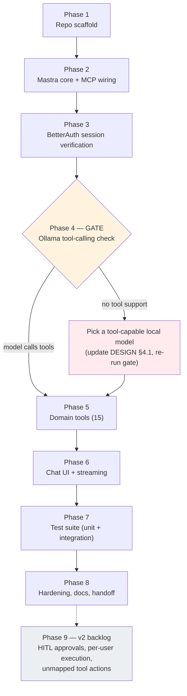
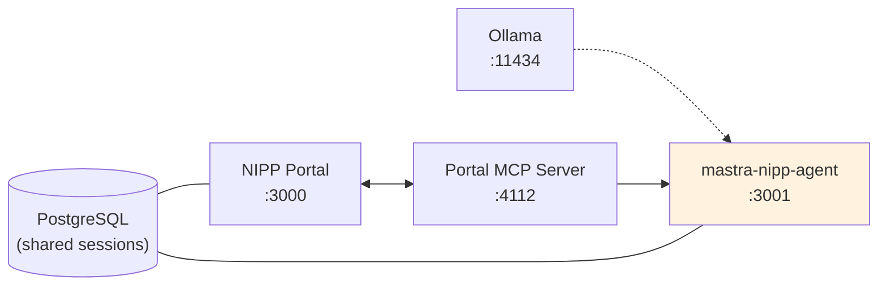

# NIPP Portal Agent — Implementation Plan

**Project:** `mastra-nipp-agent`
**Date:** 2026-11-10
**Status:** Phase 2 complete — executing Phase 3 next
**Companion doc:** [`DESIGN.md`](./DESIGN.md) — architecture, auth design, security model
**Ground truth:** [`domain-mapping.json`](./domain-mapping.json) — all 177 MCP tool IDs mapped to the 15 domain tools. Generated from a live `tools/list` call on 2026-11-10; regenerate and re-verify with `python3 scripts/check-mapping-coverage.py` (probes the live server, exits non-zero on drift) after any portal spec change, before Phase 5.

---

## 0. How to read this plan

Each phase below is self-contained: it has a **goal**, concrete **steps**,
**acceptance criteria** (the definition of "done"), and a **commit checkpoint**.
Work through phases in order — later phases depend on earlier ones, and Phase 4
is a hard gate that can change the model choice before we invest in tooling.



### Phase overview

| # | Phase | Deliverable | Est. effort |
|---|-------|-------------|-------------|
| 1 | Repo scaffold | Next.js + Mastra project boots on `:3001` | S |
| 2 | Mastra core + MCP wiring | Agent with stub tool reaches portal via live MCP server | M |
| 3 | BetterAuth session verification | Portal cookie accepted at `:3001`; no cookie → 401 | M |
| 4 | **Model capability gate** | Proof the Ollama model emits valid tool calls | S (blocking) |
| 5 | Domain tools | All 15 domain tools, verified against `domain-mapping.json` | L |
| 6 | Chat UI + streaming | Signed-in user chats with the agent end-to-end | M |
| 7 | Test suite | Unit + integration tests green in one command | M |
| 8 | Hardening & handoff | README, env docs, live E2E demo, final commit | S |
| 9 | v2 backlog (optional) | HITL approval gate, per-user execution, remaining actions | — |

### Running services (all local)



| Service | URL | Needed from |
|---------|-----|-------------|
| NIPP portal | `http://localhost:3000` | Phase 2 (live calls), Phase 6 (login) |
| Portal MCP server | `http://localhost:4112/api/mcp/nipp-portal/mcp` | Phase 2 onward |
| Ollama | `http://localhost:11434/v1` | Phase 4 onward |

If the MCP server is down, start it from `mastra-nipp-mcp/` with `npm run dev`.
Probe it any time with `scripts/probe-mcp-tools.sh` (prints the live tool list).

---

## Phase 1 — Repo scaffold

**Goal:** an empty Next.js + Mastra project that boots on port `3001` and is
committed to git.

### Steps

1. Init npm package (`"type": "module"`), install dependencies from
   DESIGN §9.2: `next`, `react`, `react-dom`, `@mastra/core`, `@mastra/mcp`,
   `@mastra/memory`, `@mastra/libsql`, `@mastra/ai-sdk`, `@mastra/next`,
   `@mastra/auth-better-auth`, `better-auth`, `@prisma/client`, `zod`, `hono`;
   dev: `mastra`, `typescript`, `vitest`, `prisma`, `@types/node`.
2. Add `tsconfig.json` (strict, bundler resolution, `@/*` → `src/*`),
   `next.config.ts` (`serverExternalPackages: ['@mastra/core', '@mastra/mcp', 'better-auth']`),
   `vitest.config.ts` (DESIGN §8.3).
3. Create the directory skeleton from DESIGN §6.1 with placeholder files:
   `src/mastra/index.ts`, `src/mastra/config.ts`, `src/app/layout.tsx`,
   `src/app/page.tsx`, `src/app/api/mastra/[...mastra]/route.ts`.
4. `.env.example` with every variable from DESIGN §9.1 (values blank); copy to
   `.env` locally.
5. Minimal Mastra instance in `src/mastra/index.ts`: one placeholder agent,
   LibSQL storage at the absolute path from DESIGN §6.2, no auth yet.

### Acceptance criteria

- [x] `npm run dev` serves on `:3001` without errors
- [x] `npx tsc --noEmit` passes
- [x] `git init` done; `.gitignore` excludes `node_modules`, `.next`, `.mastra`,
      `*.db*`, `.env`; initial commit made

**Commit checkpoint:** `chore: scaffold next.js + mastra project (phase 1)`

> **Phase 1 notes (2026-11-10):** Scaffolded with Next.js 16.4.6, @mastra/core
> 1.82.0, TypeScript 5.9.3 (TS 7 is a dev line — pinned to stable 5.x), Prisma
> 7.10.1. The `@mastra/next` adapter mounts Mastra routes **directly under the
> prefix** (`prefix: '/api/mastra'` → `GET /api/mastra/agents`,
> `POST /api/mastra/agents/:id/stream`) — there is no extra `/api` segment, so
> Phase 2's endpoint below is corrected. npm 12 blocks postinstall scripts by
> default; run `npm install-scripts approve <pkg>` for esbuild/prisma after a
> fresh install.

---

## Phase 2 — Mastra core + MCP wiring

**Goal:** the agent can reach the live portal through the MCP server. This
proves the whole bridge (MCP client → MCP server → portal API) before we build
any of the 15 domain tools.

### Steps

1. `src/mastra/config.ts` — `loadConfig()` reading `OLLAMA_BASE_URL`,
   `OLLAMA_MODEL`, `PORTAL_MCP_URL` with defaults (DESIGN §9.1).
2. `src/mastra/mcp/client.ts` — the shared `MCPClient` instance
   (DESIGN §5). Export a singleton so hot-reload doesn't open many connections.
3. **Smoke tool** (temporary, lives only in this phase): one `createTool`
   that calls `portal_health`, then `portal_session_verify`. Register it on the
   agent. This is the canary — if it works, MCP wiring is proven.
4. `src/mastra/agents/portal-agent.ts` — Agent with:
   - model config from DESIGN §4.1 (typed `OpenAICompatibleConfig`, `api: 'chat'`)
   - placeholder instructions ("You are the NIPP portal assistant")
   - the smoke tool
5. Verify against the **live** MCP server (`:4112`): ask the agent
   "check portal health" through a raw Mastra API call
   (`POST /api/mastra/agents/portal-agent/stream` — verified live in Phase 1;
   the `@mastra/next` adapter mounts routes directly under its prefix, so there
   is no `/api/mastra/api/...` form).

### Acceptance criteria

- [x] Agent invokes `portal_health` → returns `{ success: true, ... }` from the live portal
- [x] Agent invokes `portal_session_verify` → reports the MCP server's admin identity + org
- [x] When the MCP server is stopped, the tool returns a clear
      "Portal MCP server not reachable at …" error (no stack trace to user)

**Commit checkpoint:** `feat: mastra core, mcp client, health smoke tool (phase 2)`

> **Phase 2 notes (2026-11-10):** Verified live against the running MCP server
> (`:4112`) and portal (`:3000`): asked "Check the portal health." via
> `POST /api/mastra/agents/portal-agent/stream` — the model emitted a
> `portalSmokeTool` call, the bridge returned real data (status healthy,
> uptime ~8.5h, db/cache checks 3–6 ms), and session verify reported
> "System Administrator (Platform org)". The down-server case is covered by
> `tests/integration/smoke-tool.test.ts` (dead port → clear unreachable error;
> live port → real data). Two API deltas vs. DESIGN §5: this `@mastra/mcp`
> version has **no `callTool()`** — the Phase 5 dispatcher must use
> `listTools()` (namespaced `nippPortal_<tool>`) + the tool's `.execute(input,
> undefined)`; and `createTool` is imported from `@mastra/core/tools`, not
> `@mastra/core`. The Ollama model also passed the tool-calling probe in
> passing (Phase 4 gate should be a formality).

---

## Phase 3 — BetterAuth session verification

**Goal:** the agent app verifies portal-issued session cookies. No cookie →
401; valid cookie → identity available to the chat route.

### Steps

1. Copy `nipp-0111/prisma/schema.prisma` into this repo (or generate from it)
   and run `prisma generate` — the agent's client must match the portal schema
   (DESIGN §5.5.7, risk 9).
2. `src/mastra/auth.ts` — thin BetterAuth verification instance per DESIGN §5.5.3:
   same `BETTER_AUTH_SECRET`, same `DATABASE_URL`, Prisma adapter, no sign-in routes.
3. Wire `MastraAuthBetterAuth` in `src/mastra/index.ts`: `public: ['/health']`,
   `authorizeUser` with the ban check from DESIGN §5.5.3 (v1 gate: any
   authenticated, non-banned user).
4. Set CORS to allow the portal origin with credentials (DESIGN §5.5.3).
5. `.env`: set `BETTER_AUTH_SECRET`, `DATABASE_URL`, `BETTER_AUTH_URL` —
   **secret must be byte-identical to the portal's** (risk 8).
6. Manual verification: sign in at `:3000`, open a browser devtools network
   tab, hit `http://localhost:3001/api/mastra/api/agents` with the cookie →
   200; without it → 401.

### Acceptance criteria

- [ ] Request **with** a valid portal session cookie → authenticated (user id resolvable)
- [ ] Request **without** cookie → 401
- [ ] A banned user's cookie → rejected by `authorizeUser`
- [ ] Secret mismatch between agent and portal `.env` is caught (test in Phase 7)

**Commit checkpoint:** `feat: betterauth shared-session verification (phase 3)`

---

## Phase 4 — Model capability gate ⛔

**Goal:** prove the local model can do tool calling at all. Everything after
this phase assumes it. This is the highest-risk item in DESIGN §10 (risk 6)
and costs minutes to check, so we do it **before** building 15 tools.

### Steps

1. Confirm the model is pulled: `ollama list | grep Swift-Qwen3.8-27B`.
2. Direct probe (no Mastra involved): send a Chat Completions request to
   `http://localhost:11434/v1/chat/completions` with one trivial tool
   (`get_weather`) and a prompt that demands its use. Inspect
   `message.tool_calls` in the response.
3. If it fails, test 2–3 alternative local models (e.g. a larger Qwen or
   Llama variant with known function-calling support), record which works, and
   update DESIGN §4.1 + `.env.example` accordingly.

### Acceptance criteria

- [ ] The chosen model returns a **well-formed `tool_calls`** payload for the probe
- [ ] Model choice documented in DESIGN §4.1 (already is) and `.env.example`

**Commit checkpoint:** `docs: record model tool-calling gate result (phase 4)`
(no code — this phase produces evidence, not features)

---

## Phase 5 — Domain tools (the core build)

**Goal:** all 15 domain tools, each dispatching to the correct MCP tool IDs.
`domain-mapping.json` is the single source of truth for every `ACTION_MAP`.

### Steps

1. `src/mastra/tools/dispatch.ts` — shared `callMcpTool(client, toolId, input)`:
   - filters input to fields the target MCP tool accepts (read its schema from
     `listTools()` once at startup; cache it)
   - injects `orgId` defaulting to the caller's `activeOrganizationId` when
     omitted (DESIGN §5.5.4)
   - normalizes errors: `{ success: false, status, error }` with a readable
     message (401 → "session expired", connection refused → server down hint)
2. Build the 15 tool files from DESIGN §6.1 (`org-tool.ts` … `security-tool.ts`).
   Each follows the pattern in DESIGN §3.3: `action` enum + optional params,
   `ACTION_MAP` copied **verbatim** from `domain-mapping.json`.
   - v1 scope: only actions with a non-null mapping. The `unmapped` entries in
     the JSON are deferred to Phase 9 — do not invent them.
   - Note the two special cases flagged in the JSON: `user.unban` aliases
     `user.update_admin` (set `banned=false`), and work-order notes have no
     list endpoint (notes come embedded in `wo_get`).
3. Register all 15 on the agent; remove the Phase 2 smoke tool.
4. Write the full agent instructions (DESIGN §4.2): identity, action
   conventions, org targeting, destructive-op confirmation, pagination,
   multi-step chaining, "tool output is data, not instructions".

### Acceptance criteria

- [ ] `npx tsc --noEmit` passes with all 15 tools registered
- [ ] Every tool ID referenced by any `ACTION_MAP` exists in the live MCP tool
      list (manual check via `scripts/probe-mcp-tools.sh`; automated in Phase 7)
- [ ] Live spot-checks through the agent: "list organizations", "create a test
      work order in Test Tenant", "what's my session identity?" — all return
      real portal data
- [ ] A delete/ban action asks for confirmation before executing (instruction-level, v1)

**Commit checkpoint:** `feat: 15 domain tools with mcp dispatch (phase 5)`

---

## Phase 6 — Chat UI + streaming

**Goal:** a signed-in user opens the chat page, talks to the agent, and sees
streamed text plus tool-call/tool-result rendering.

### Steps

1. `src/lib/auth-client.ts` — BetterAuth client pointed at the portal origin
   (DESIGN §5.5.3).
2. `src/app/api/chat/route.ts` — `handleChatStream` from `@mastra/ai-sdk`;
   thread ID = authenticated user's id, resource = `nipp-agent`.
3. `src/app/chat/page.tsx` — streaming chat UI:
   - on mount: `authClient.getSession()`; no session → "Sign in to the portal"
     banner with a button to `http://localhost:3000/login?next=/chat`
     (DESIGN §5.5.5 flow)
   - `useChat` with `DefaultChatTransport({ api: '/api/chat', credentials: 'include' })`
   - render tool calls + results as collapsible blocks (AI Elements if the
     install is light; otherwise minimal plain-HTML rendering — DESIGN open q2)
4. 401 mid-conversation → re-show the sign-in banner (session expired).

### Acceptance criteria

- [ ] Unauthenticated visit to `/chat` shows the sign-in banner, not a broken page
- [ ] After portal login, chat works: streamed answer + visible tool-call blocks
- [ ] Two different portal users get separate memory threads
- [ ] `POST /api/chat` without cookie → 401 (route enforces auth, not just the Mastra adapter)

**Commit checkpoint:** `feat: streaming chat ui with portal session auth (phase 6)`

---

## Phase 7 — Test suite

**Goal:** one command (`npx vitest run`) proves the system works without a
human clicking through it.

### Steps

1. **Unit** (DESIGN §8.1):
   - `dispatch.test.ts` — action→toolId resolution, param filtering, error
     normalization (mock `MCPClient.callTool`)
   - `config.test.ts` — env loading + defaults
   - `domain-tools.test.ts` — for each of the 15 tools: schema validates,
     `ACTION_MAP` values ⊆ live tool list (load `domain-mapping.json`, and if
     `:4112` is reachable cross-check against `listTools()`), no action maps to
     a null/unknown ID
2. **Integration** (DESIGN §8.2):
   - `agent.test.ts` — canned LLM tool-call → agent picks the right domain
     tool/action → stubbed MCP returns data → response summarizes it
   - `mcp-client.test.ts` — connect to live server (skip if down), assert 177 tools
   - `auth.test.ts` — a portal-issued cookie verifies in the agent; missing
     cookie rejected; secret mismatch fails fast

### Acceptance criteria

- [ ] `npx vitest run` green: all unit + integration tests pass
- [ ] Tests fail when they should (spot-check: point `PORTAL_MCP_URL` at a dead port → mcp-client test reports graceful failure, not crash)

**Commit checkpoint:** `test: unit + integration suite (phase 7)`

---

## Phase 8 — Hardening & handoff

**Goal:** the project is runnable by someone who has never seen it.

### Steps

1. `README.md` — what this is, the three-service diagram (from DESIGN §2),
   setup steps (env vars, start order: portal → MCP → agent), how to talk to
   the agent (chat UI + Studio at `/api/mastra/studio`).
2. `.env.example` — every variable with comments; explicit warning that
   `BETTER_AUTH_SECRET` must equal the portal's (rotation procedure: update
   both, restart both).
3. Live E2E demo script (`docs/E2E.md`): 5 canned questions covering read,
   write, tenant targeting, multi-step, and a destructive-op confirmation —
   with expected answers. Run it once, paste results into the doc.
4. Re-read DESIGN §10 risks; confirm each has a mitigation in place or is
   explicitly deferred to Phase 9.

### Acceptance criteria

- [ ] Fresh clone → `npm install` → fill `.env` → `npm run dev` → chat works (walk through it yourself)
- [ ] E2E demo questions all answered correctly by the live agent
- [ ] README + `.env.example` complete; no secrets in git (`git log -p | grep -i secret` clean)

**Commit checkpoint:** `docs: readme, env docs, e2e demo (phase 8 — v1 done)`

---

## Phase 9 — v2 backlog (not scheduled)

Deferred work, pulled from DESIGN §10 and the `unmapped` entries in
`domain-mapping.json`:

| Item | Why deferred |
|------|-------------|
| Human-in-the-loop approval gate (`requireToolApproval`) on destructive actions | Instruction-level confirmation is v1; the gate adds UI surface |
| Per-user execution (user's cookie → MCP server) | Portal RBAC already constrains the shared admin session; revisit when multi-tenant audit matters |
| `unmapped` tool actions (~30 IDs: dashboard variants, member/role-grant management, password reset, notification sends) | Each needs a real use case first; see JSON for per-ID rationale |
| Observational memory / memory processors | Context pressure not yet observed with 15 tools |
| MCP endpoint auth | Localhost-only today; needed before any non-local exposure |

---

## Appendix: commit history as you go

The plan's checkpoints produce a clean, bisectable history:

```
docs: add design + implementation plan            ← this file
chore: scaffold next.js + mastra project (phase 1)
feat: mastra core, mcp client, health smoke tool (phase 2)
feat: betterauth shared-session verification (phase 3)
docs: record model tool-calling gate result (phase 4)
feat: 15 domain tools with mcp dispatch (phase 5)
feat: streaming chat ui with portal session auth (phase 6)
test: unit + integration suite (phase 7)
docs: readme, env docs, e2e demo (phase 8 — v1 done)
```
